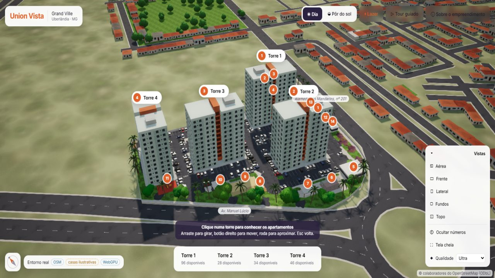
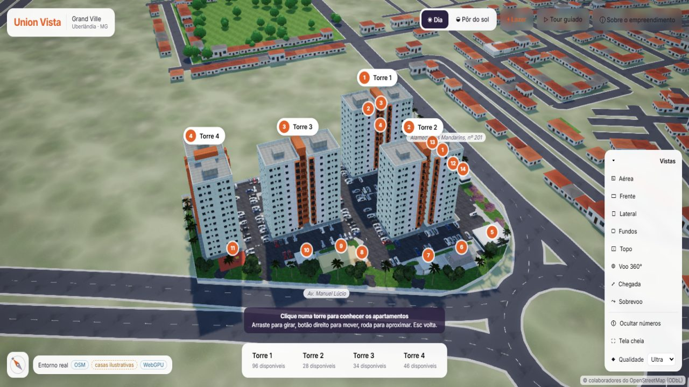
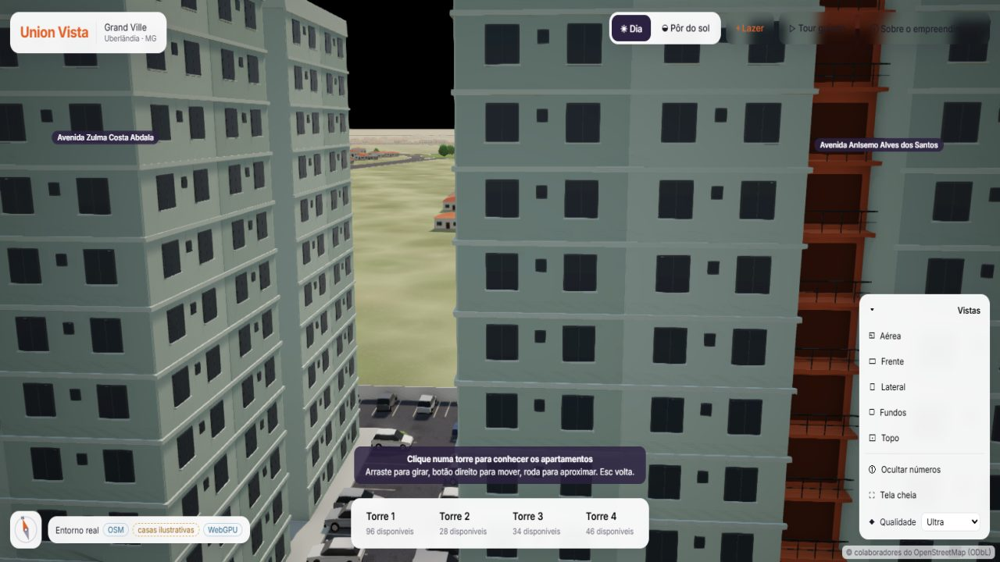
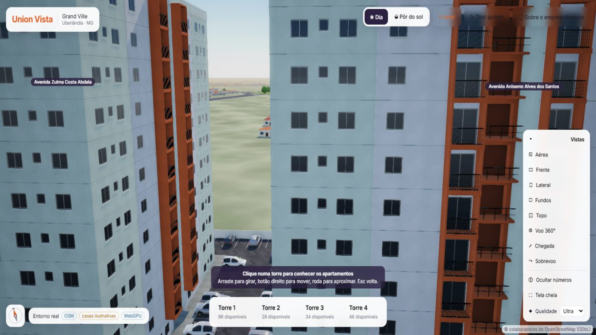
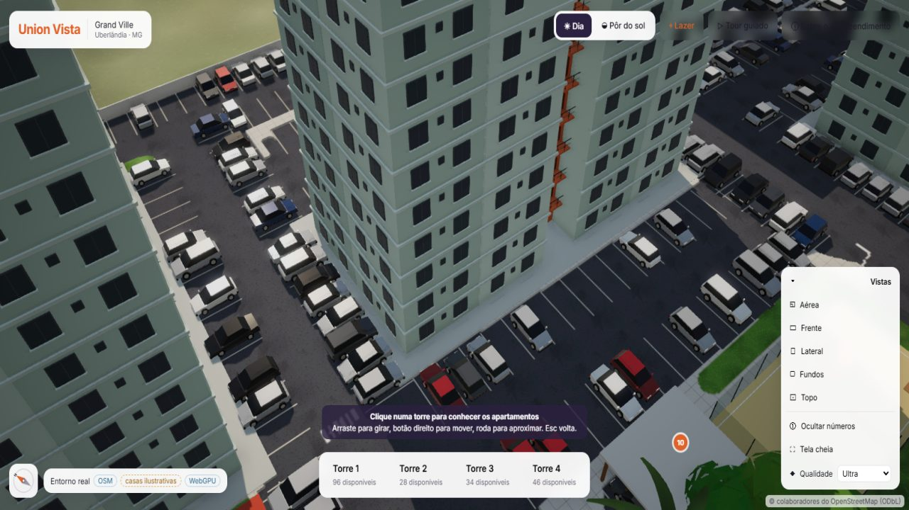
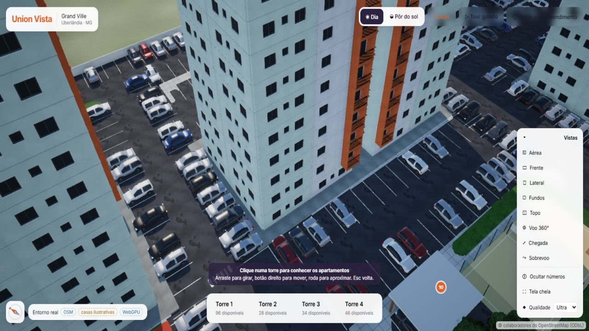
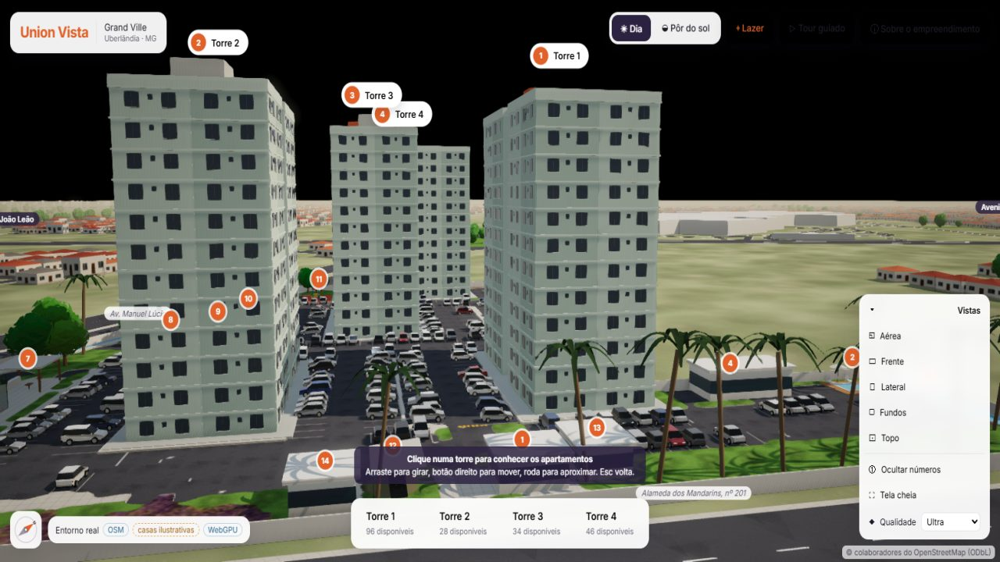
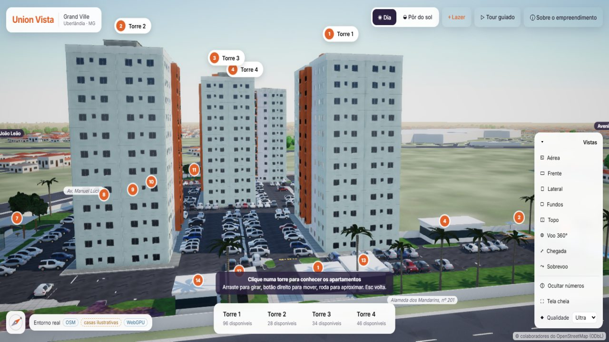
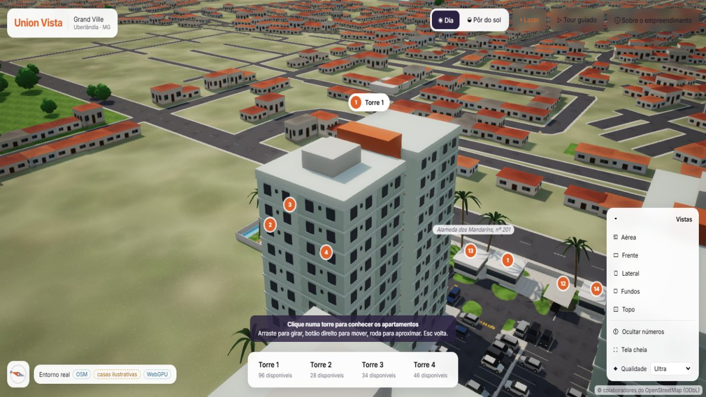
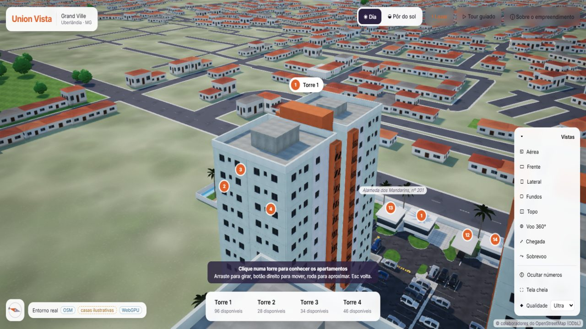

# Maquete do Union Vista: modelos do Blender, PBR e iluminação HDR

Esta etapa melhora a maquete navegável do visualizador sem trocar de motor: Babylon.js 9 (WebGPU com recuo para WebGL2), painel Angular, API Node/NestJS com MySQL e Blender headless. Tudo o que entrou é gratuito e pode ser usado comercialmente. Os modelos e texturas são gerados por código no próprio Blender, sem baixar nada de terceiros. A cena continua navegável: seleção de torre, andar e apartamento, áreas comuns, tour e planta 3D.

## O que foi feito

| Item pedido | Como ficou |
|---|---|
| 1. Pipeline Blender/Python de GLB | `scripts/blender/build_tower.py` (versão 2) gera a torre a partir de `model3d` e `model3d.facade`. `scripts/blender/build_library.py` gera a biblioteca: texturas, céu, vegetação e carros. A API gera o GLB e já o põe em uso (`POST buildings/:id/model/generate` com `{ activate: true }`, `PUT buildings/:id/model/viewer`). `scripts/blender/union-vista-torres.mjs` faz isso para as 4 torres. |
| 2. Fachadas | Painéis em dois tons com vão real nas janelas (14 cm), caixilho com montante, peitoril com pinga-água, juntas entre pavimentos, faixa do núcleo na cor de destaque com varandas em balanço, laje, abas, testeira e guarda-corpo de barras. Também platibanda com rufo, casa de máquinas e reservatório. |
| 3. Materiais PBR | Concreto, reboco pintado, asfalto, piso em placas, grama e metal escovado, todos sem emenda, com albedo, normal e ORM (oclusão, rugosidade, metal). Vidros com reflexo do céu, pintura dos carros com verniz (clearcoat) e borracha. |
| 4. Iluminação | Céu físico do Cycles (dia e pôr do sol) em HDR: é o fundo, o reflexo e a luz de ambiente. Sol direcional com sombras em cascata e PCF, SSAO2, ACES, contraste, vinheta e bloom (Alta e Ultra). |
| 5. Vegetação | Árvore de copa arredondada, palmeira e arbusto em GLB, com folhas em cartões recortados por alfa e dois níveis de detalhe, desenhados com instâncias finas. As posições vêm da arte (árvores detectadas e palmeiras junto ao muro). |
| 6. Veículos | Hatch (3,94 × 1,72 m), sedã (4,47 × 1,74 m) e SUV (4,20 × 1,79 m). Cada um tem carroceria por seções com caixas de roda, cabine de vidro com colunas e teto pintados, rodas de liga, faróis, lanternas, para-choques, soleiras e retrovisores, em dois níveis de detalhe. A cor de cada carro é a da arte. |
| 7. Terreno e ruas | Continuam alinhados à implantação calibrada e ao OpenStreetMap (ver `docs/implantacao-geografica.md`). O chão do lote agora usa um material PBR por classe (asfalto, grama, piso), com as faixas e as linhas das vagas numa camada por cima. |
| 8. Câmeras | Voos em arco (sobem como drone nos deslocamentos longos) e três trajetos em spline com velocidade de cruzeiro: Voo 360°, Chegada (rasante pela frente subindo até a vista aérea) e Sobrevoo. Arrastar ou rolar interrompe o voo. |
| 9. Otimização | Instâncias finas agrupadas por região, com troca de nível de detalhe pela distância. Peças do mesmo material fundidas, de modo que um carro passa de cerca de 20 malhas para 7. Detalhes finos das torres (caixilhos, guarda-corpos, juntas) somem ao longe. Carros distantes não projetam sombra. Matrizes congeladas no que é estático. Texturas em WebP com mipmaps e versão de 512 px nos níveis baixos. |
| 10. Qualidade | Baixa, Média, Alta e Ultra. O nível muda sombras, SSAO, antisserrilhado, resolução, bloom, resolução das texturas e distâncias de detalhe. O nível inicial é detectado pelo aparelho. |

## O que veio do material do cliente e o que é estimado

A fachada segue o e-book. As cores, a faixa do núcleo com varandas e o guarda-corpo metálico vêm do render das págs. 1 e 3. A varanda gourmet de 2,30 m nos finais junto ao núcleo vem da planta 01, pág. 7. A quantidade de pavimentos e de apartamentos não mudou: 12 pavimentos e 8 por andar em cada torre.

Itens sem cota no material ficam em `model3d.facade.estimated`. O painel mostra o selo **estimado** ao lado de cada um, e o selo some quando o valor é corrigido. Hoje estão estimados:

- tamanho e peitoril das janelas;
- janela do banheiro;
- balanço da varanda (1,20 m);
- tons exatos (amostrados no render);
- cores do caixilho, do guarda-corpo e do vidro.

A fonte fica gravada em `model3d.facade.source`. Para corrigir: **Torres e pavimentos → Maquete 3D → Fachada do modelo detalhado → Salvar → Gerar modelo 3D (Blender)**.

## Comparativo (mesmas câmeras)

Build de produção das duas versões (antes: `4bf073c`), mesmas 5 câmeras com alvo e ângulos fixos, Chrome headless com WebGPU, 1600 × 900, cache desligado. Script: `scripts/bench/viewer-bench.mjs`.

| Câmera | Antes | Depois |
|---|---|---|
| Aérea |  |  |
| Fachada |  |  |
| Estacionamento |  |  |
| Rua |  |  |
| Topo da Torre 3 |  |  |

Outras vistas da versão nova: [carros](img/maquete-comparativo/extra-carros.jpg), [chegada cinematográfica](img/maquete-comparativo/extra-chegada.jpg), [pôr do sol com o apartamento selecionado](img/maquete-comparativo/extra-por-do-sol.jpg) e [torre selecionada](img/maquete-comparativo/extra-torre-selecionada.jpg).

### Medições

| Ultra | Antes | Depois |
|---|---|---|
| Pronto para navegar | ~4,0 s¹ | 2,3 s |
| Download (comprimido) | 1,0 MB | 18,0 MB² |
| FPS (mediana por câmera)³ | 180 em todas | 180 · 136 · 136 · 179 · 159 |
| Chamadas de desenho por quadro | 602 a 766 | 1.101 a 1.285 |
| Triângulos desenhados por quadro (todas as passadas) | 3,7 milhões | 9,8 a 10,9 milhões |
| Triângulos únicos na memória | 40 mil | 347 mil |
| Memória de texturas (estimativa) | 267 MB | 442 MB |
| Memória JavaScript | 56 MB | 124 MB |

| Baixa | Antes | Depois |
|---|---|---|
| Pronto para navegar | ~4,0 s¹ | 2,0 s |
| Download (comprimido) | 1,0 MB | 15,8 MB |
| FPS³ | 180 em todas | 180 em todas |
| Chamadas de desenho por quadro | 298 a 381 | 424 a 539 |
| Memória de texturas (estimativa) | 98 MB | 222 MB |

¹ A versão anterior não marca o fim do carregamento: o tempo é o de quando os carros aparecem. A nova marca `readyAt` depois do chão, dos carros, da vegetação e dos modelos das torres.
² 12,9 MB são os quatro GLB das torres (3,2 MB cada, com texturas) e cerca de 5 MB a biblioteca.
³ O Chrome headless limita a 180 quadros por segundo, então 180 quer dizer "no limite". Os números são da mesma máquina e servem para comparar as versões, não como garantia em outros aparelhos.

## Limitações e próximos passos

- **Texturas comprimidas para GPU (KTX2/Basis):** não entraram, porque o codificador (KTX-Software, Apache-2.0) precisa ser instalado e eu não baixei ferramentas de fora. As texturas estão em WebP, com mipmaps e versão de 512 px nos níveis Baixa e Média. Com o `toktx` instalado, basta converter `apps/viewer/public/library/textures` e os GLB.
- **Tamanho dos GLB das torres:** a geometria não está comprimida (Draco ou meshopt). As 4 torres têm os mesmos parâmetros, então um modelo só, instanciado, cortaria cerca de 10 MB. Exige separar as janelas acesas, que hoje são sorteadas por torre.
- **Relevo:** o terreno continua plano. O lote e as ruas seguem a implantação calibrada e o OSM, sem curvas de nível. Não há dado de altimetria no material.
- **Mapa de normal nas fachadas:** ficou desligado. Com UV planar espelhada e sem tangentes ele mancha, e com tangentes o shader passa do limite de 16 variáveis entre estágios do WebGPU (com sombras em cascata e instâncias). O relevo do reboco não aparece na escala do prédio. No chão e nos carros o mapa de normal está ligado.
- **Sombras finas:** as barras do guarda-corpo projetam listras nas abas laranja quando o sol está baixo. É o comportamento esperado da sombra, mas pode parecer serrilhado de longe.
- **Painel:** a tela nova de fachada compila, mas não foi testada com login no navegador.

## Como regenerar

```bash
# Biblioteca (texturas, céu HDR, vegetação e carros) em apps/viewer/public/library
"$BLENDER_PATH" -b --factory-startup --python scripts/blender/build_library.py -- apps/viewer/public/library --res 1024

# Fachada do e-book e GLB das 4 torres do Union Vista, já em uso no visualizador
npm run build --workspace=@vistahub/api
node scripts/blender/union-vista-torres.mjs

# Medições (produção: vite preview com ?medir)
node scripts/bench/viewer-bench.mjs depois "http://localhost:4310/union-vista?medir" ultra
```
